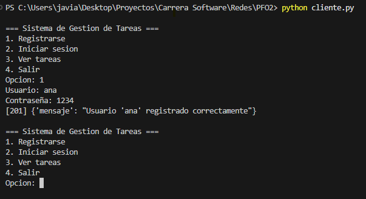
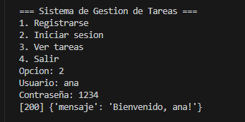
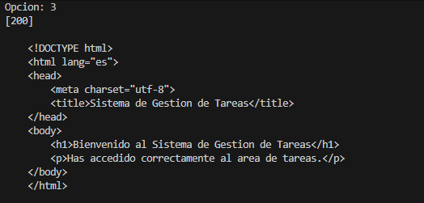
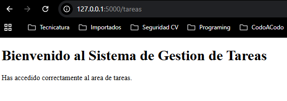
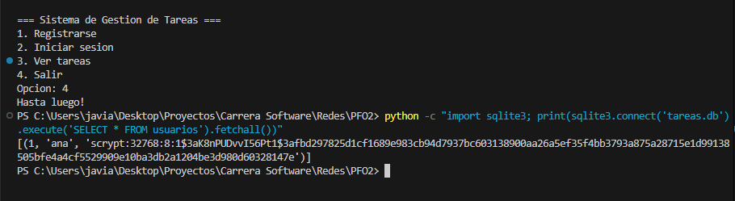

# PFO2 — Sistema de Gestión de Tareas con API y Base de Datos

Trabajo Práctico Formativo Obligatorio 2 — Materia: Redes.

API REST construida con **Flask**, autenticación con **contraseñas hasheadas** (werkzeug.security / scrypt) y persistencia en **SQLite**. Incluye un **cliente de consola** que consume la API vía HTTP.

## Estructura del proyecto

| Archivo            | Descripción                                          |
| ------------------ | ---------------------------------------------------- |
| `servidor.py`      | API Flask con los endpoints `/registro`, `/login` y `/tareas`. |
| `cliente.py`       | Cliente de consola que interactúa con la API.        |
| `requirements.txt` | Dependencias del proyecto.                           |
| `capturas/`        | Capturas de pantalla de las pruebas exitosas.        |
| `tareas.db`        | Base de datos SQLite (se genera automáticamente).    |

## Requisitos

- Python 3.10 o superior
- pip

## Instalación

```bash
pip install -r requirements.txt
```

## Ejecución

**1. Levantar el servidor** (en una terminal):

```bash
python servidor.py
```

El servidor queda escuchando en `http://127.0.0.1:5000` y crea `tareas.db` automáticamente la primera vez.

**2. Usar el cliente de consola** (en otra terminal):

```bash
python cliente.py
```

Menú disponible:

```
=== Sistema de Gestion de Tareas ===
1. Registrarse
2. Iniciar sesion
3. Ver tareas
4. Salir
```

## Cómo probar la API

### Con el cliente de consola

1. Opción `1` → registrar un usuario (ej: `ana` / `1234`).
2. Opción `2` → iniciar sesión con ese usuario.
3. Opción `3` → ver el HTML de bienvenida de `/tareas`.

### Con curl (alternativa)

```bash
# Registro
curl -X POST http://127.0.0.1:5000/registro -H "Content-Type: application/json" -d "{\"usuario\": \"ana\", \"contraseña\": \"1234\"}"

# Login
curl -X POST http://127.0.0.1:5000/login -H "Content-Type: application/json" -d "{\"usuario\": \"ana\", \"contraseña\": \"1234\"}"

# Tareas (devuelve HTML)
curl http://127.0.0.1:5000/tareas
```

### Verificar que la contraseña NO se guarda en texto plano

```bash
python -c "import sqlite3; print(sqlite3.connect('tareas.db').execute('SELECT * FROM usuarios').fetchall())"
```

La columna `password_hash` muestra algo como `scrypt:32768:8:1$AbCd...$1234...` — nunca la contraseña original.

## Endpoints

| Método | Ruta       | Body JSON                                    | Respuesta exitosa            |
| ------ | ---------- | -------------------------------------------- | ---------------------------- |
| POST   | `/registro` | `{"usuario": "nombre", "contraseña": "1234"}` | `201` + mensaje de confirmación |
| POST   | `/login`    | `{"usuario": "nombre", "contraseña": "1234"}` | `200` + mensaje de bienvenida   |
| GET    | `/tareas`   | —                                            | `200` + HTML de bienvenida      |

## Capturas de pantalla

### 1. Registro de usuario (opción 1 del cliente)



### 2. Inicio de sesión (opción 2 del cliente)



### 3. Consulta de tareas desde el cliente (opción 3)



### 4. HTML de bienvenida de GET /tareas en el navegador



### 5. Contraseña hasheada en la base de datos



## Respuestas conceptuales

### ¿Por qué hashear contraseñas?

Guardar contraseñas en texto plano es un riesgo crítico: si la base de datos se filtra, el atacante obtiene las credenciales de TODOS los usuarios inmediatamente, y como la gente reutiliza contraseñas, el daño se extiende a otros servicios.

El **hashing** es una función de un solo sentido: es trivial calcular el hash de una contraseña, pero computacionalmente inviable obtener la contraseña a partir del hash. Así, aunque la base se filtre, el atacante solo obtiene hashes inútiles.

Además, `werkzeug.security` (la librería usada) aplica dos defensas extra:

- **Salt aleatorio**: agrega datos aleatorios únicos a cada contraseña antes de hashearla. Dos usuarios con la misma contraseña generan hashes distintos, lo que anula los ataques con tablas precalculadas (rainbow tables).
- **Algoritmo lento (scrypt)**: está diseñado para ser costoso en tiempo y memoria, lo que hace impracticable probar millones de combinaciones por fuerza bruta.

### Ventajas de usar SQLite en este proyecto

1. **Cero configuración**: no requiere instalar ni correr un servidor de base de datos separado. La base es un solo archivo (`tareas.db`) que se crea automáticamente.
2. **Portabilidad**: el proyecto completo (código + datos) se puede copiar o entregar tal cual, ideal para un trabajo práctico.
3. **Viene incluida con Python**: el módulo `sqlite3` es parte de la librería estándar, sin dependencias externas.
4. **Suficiente para la escala**: para una aplicación con un único proceso servidor y volumen bajo de usuarios, SQLite es más que adecuado y evita la complejidad innecesaria de un motor cliente-servidor como PostgreSQL o MySQL.

## Nota sobre GitHub Pages

GitHub Pages sirve únicamente **contenido estático** (HTML/CSS/JS): no puede ejecutar el servidor Flask ni Python. Lo habitual es publicar en Pages la **documentación** del proyecto (este README renderizado), mientras que el código se ejecuta localmente siguiendo las instrucciones de arriba.
